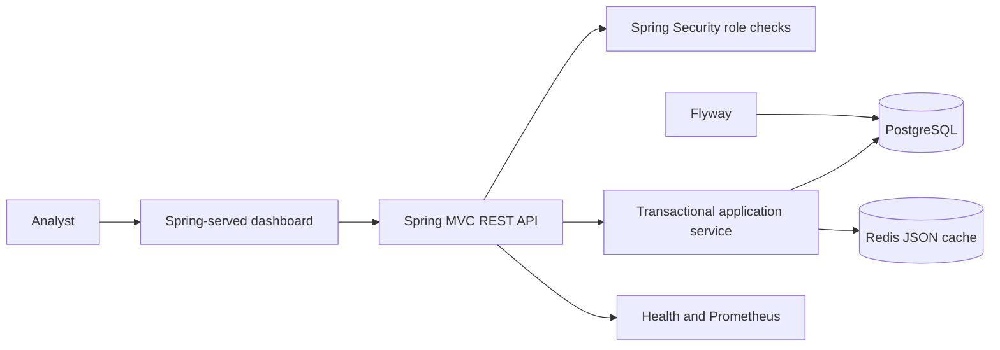
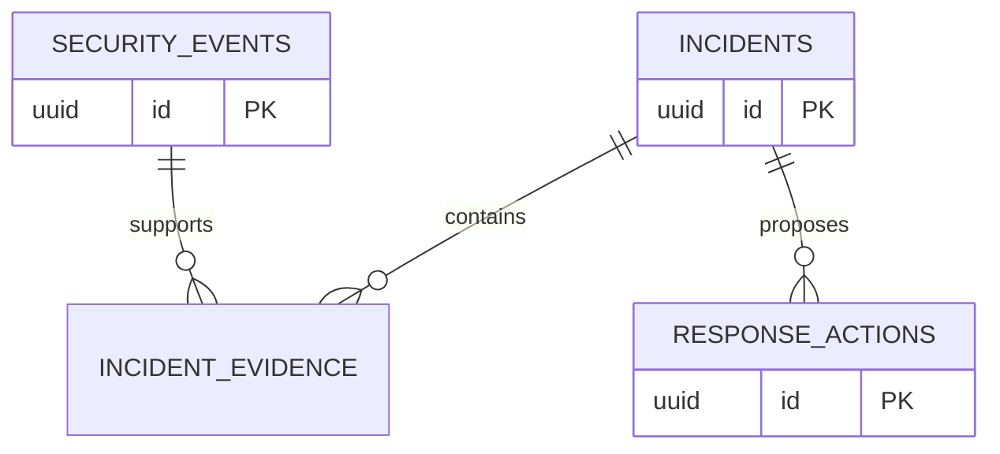

# SentinelFlow

SentinelFlow is an independently deployable defensive SIEM/SOAR application. It ingests synthetic security events, correlates repeated authentication failures into an incident, preserves evidence, and records analyst approval for simulated response actions.

## Product Design

The SOC workspace is organized around a recent-event table and incident triage queue. Analysts can filter telemetry, launch a deterministic demo scenario, review incident evidence, and submit approval decisions. The interface is served by Spring Boot and uses same-origin REST requests. Its visual design is a compact operations console rather than a marketing site.

## Technical Features

- Java 21, Spring Boot 3.5, Maven Wrapper 3.9.9.
- PostgreSQL with a separate `sentinelflow` database and `sentinelflow_app` owner role.
- Flyway schema migrations and indexes for events, incidents, evidence, and response actions.
- Spring JDBC transactions for incident, evidence, and action writes.
- Password-protected Redis JSON read cache with app-specific key prefix and 30-second TTL.
- Spring Security HTTP Basic roles: `ADMIN`, `ANALYST`, and `VIEWER`.
- Spring Boot Actuator health and Prometheus metrics.
- Non-root multi-stage Docker image, Compose health checks, named data volumes, and GitHub Actions CI.
- Tests for domain behavior, authorization boundaries, and Docker-optional PostgreSQL/Redis persistence.

## Architecture





Incident creation stores its events, ordered evidence references, and pending actions in one database transaction. Every action is a mock; approval only changes its recorded status.

## Run With Docker

Requirements: Docker Desktop with the Linux container engine enabled. Run these commands from this repository's root:

```powershell
Copy-Item .env.example .env
docker compose up --build
```

Open [http://localhost:8081](http://localhost:8081). PostgreSQL and Redis are private to the Compose network except for loopback-bound developer ports `5433` and `6381`. Stop the project with `docker compose down`; named volumes preserve data. `docker compose down -v` removes the data volumes.

## Build, Test, And Run Locally

Requirements: JDK 21. Start only this repository's database and cache:

```powershell
Copy-Item .env.example .env
docker compose up -d postgres redis
```

Run checks and package the app:

```powershell
& (Join-Path $PWD 'mvnw.cmd') --batch-mode clean verify
& (Join-Path $PWD 'mvnw.cmd') clean package
```

Start the app in its own terminal:

```powershell
& (Join-Path $PWD 'mvnw.cmd') spring-boot:run
```

Or run the packaged JAR:

```powershell
java -jar target/sentinelflow-0.1.0.jar
```

For Docker builds only, run `docker compose build sentinelflow`; `docker compose up --build` builds and starts the full local stack.

## Local Accounts And Authorization

These are local demo credentials; override them in `.env` before sharing the stack.

| Role | Username | Default password | Permissions |
| --- | --- | --- | --- |
| Admin | `admin` | `local-admin-change-me` | Read, analyst operations, approve/reject actions, Prometheus |
| Analyst | `analyst` | `local-analyst-change-me` | Read and create demo incidents |
| Viewer | `viewer` | `local-viewer-change-me` | Read-only |

The dashboard holds HTTP Basic credentials in tab-scoped session storage. Direct API example:

```powershell
curl.exe -u viewer:local-viewer-change-me http://localhost:8081/api/v1/events
```

| Method | Endpoint | Required role |
| --- | --- | --- |
| `GET` | `/api/v1/events` | Viewer or higher |
| `GET` | `/api/v1/incidents` | Viewer or higher |
| `POST` | `/api/v1/demo/suspicious-login` | Analyst or admin |
| `POST` | `/api/v1/incidents/{incidentId}/actions/{actionId}/approval` | Admin |
| `GET` | `/actuator/health` | Public health status |
| `GET` | `/actuator/prometheus` | Admin |

## CI And Safety

`.github/workflows/ci.yml` runs Maven Wrapper verification and builds the Docker image on pushes and pull requests. Dependabot checks Maven, Docker, and GitHub Actions updates. See [SECURITY.md](SECURITY.md) for reporting and deployment guidance.

This is a local defensive portfolio product, not a production SIEM. Events and response actions are synthetic. Demo users are in-memory, HTTP Basic is not suitable for public deployment, and no connector changes external infrastructure. Use TLS and OIDC for real deployments.
